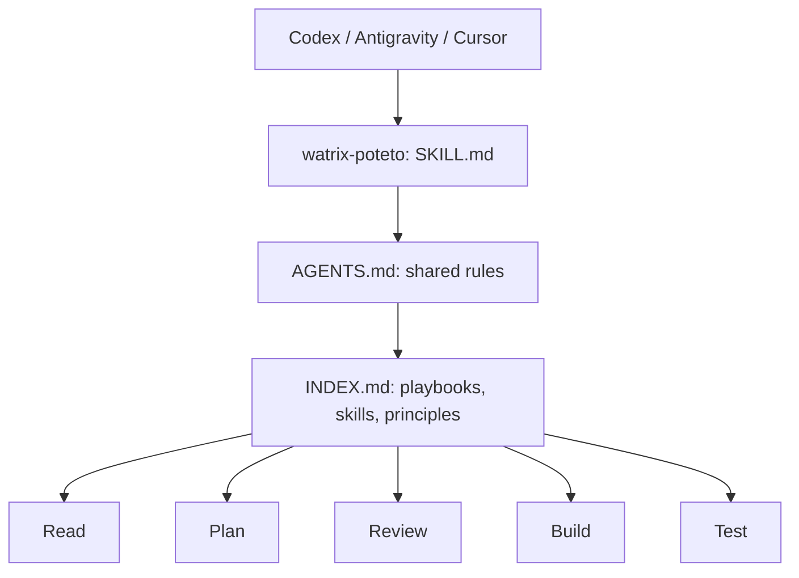

# Watrix_poteto

A pstack-based workflow kit for Codex, Antigravity, and Cursor. Five playbooks cover the common modes; a shared index resolves the original playbooks, skills, and principles as needed.

## Install

### Codex desktop

In a local Codex chat, select `$skill-installer` and send this prompt:

```text
$skill-installer Install the skills/watrix-poteto directory from https://github.com/Waaaaatrix/Watrix_poteto
```

After installation, open a new chat and select `watrix-poteto` from the skill picker. [Codex skill installer](https://learn.chatgpt.com/docs/build-skills#install-curated-skills-for-local-use)

### Antigravity desktop

Open the app's integrated terminal and run:

```sh
npx skills add Waaaaatrix/Watrix_poteto --skill watrix-poteto -a antigravity -g
```

Open a new conversation and type `/watrix-poteto`. [Antigravity skills](https://antigravity.google/docs/skills#invoking-skills-in-the-antigravity-app)

### Cursor desktop

Open the integrated terminal in Cursor and run:

```sh
npx skills add Waaaaatrix/Watrix_poteto --skill watrix-poteto -a cursor -g
```

In a new Agent chat, select `watrix-poteto` from the `/` menu. [Cursor skills](https://cursor.com/docs/skills)

The terminal commands require Node.js and npm. For a project-only install, run the command from the project root without `-g`. [Skills CLI options](https://github.com/vercel-labs/skills/blob/main/docs/commands.md#skills-add)

**Without a terminal:** On GitHub, choose **Code > Download ZIP** and extract it. Use your file manager to put the entire `skills/watrix-poteto` folder under `~/.gemini/config/skills/` for Antigravity or `~/.cursor/skills/` for Cursor. For one project shared by all three apps, put it under the project's `.agents/skills/` instead.

## Use

In Codex, select `$watrix-poteto`; in Cursor or Antigravity, select `watrix-poteto` in the skill picker or reference it by name. Send the mode and task in the same message.

| Mode | Use it for | Example |
| --- | --- | --- |
| `\read` | Investigate code, trace behavior, or resume from a handoff | `\read Trace how a training batch reaches the model.` |
| `\plan` | Plan a change, compare designs, or prepare a handoff | `\plan Outline the data format migration.` |
| `\review` | Summarize changes with locations and present the line-by-line diff | `\review Show this branch's changes against main.` |
| `\build` | Route implementation to the relevant playbook | `\build bug-fix Fix the inconsistent date filter.` |
| `\test` | Run the smallest necessary test set and report concrete evidence | `\test Check the date filter's month boundary.` |

The backslash modes are prompt text. Tests are written or run only when the user explicitly invokes `\test`. Read-only inspection of source, diffs, existing logs, and CI results is available in the other modes.

## Architecture



The [installable bundle](skills/watrix-poteto/) contains all five categories. Each holds its playbooks, skills, and principles. The [index](skills/watrix-poteto/INDEX.md) is the lookup table for cross-category references. The original Test playbooks remain archived under Test; `test.md` is the active entry. Inherited workflows that need a host-specific tool use that tool where available.

## License

MIT. Based on [pstack](https://github.com/cursor/plugins/tree/main/pstack) and its [cross-host mirror](https://github.com/backnotprop/pstack). See the [project license](LICENSE) and [upstream license](skills/watrix-poteto/upstream/LICENSE).
